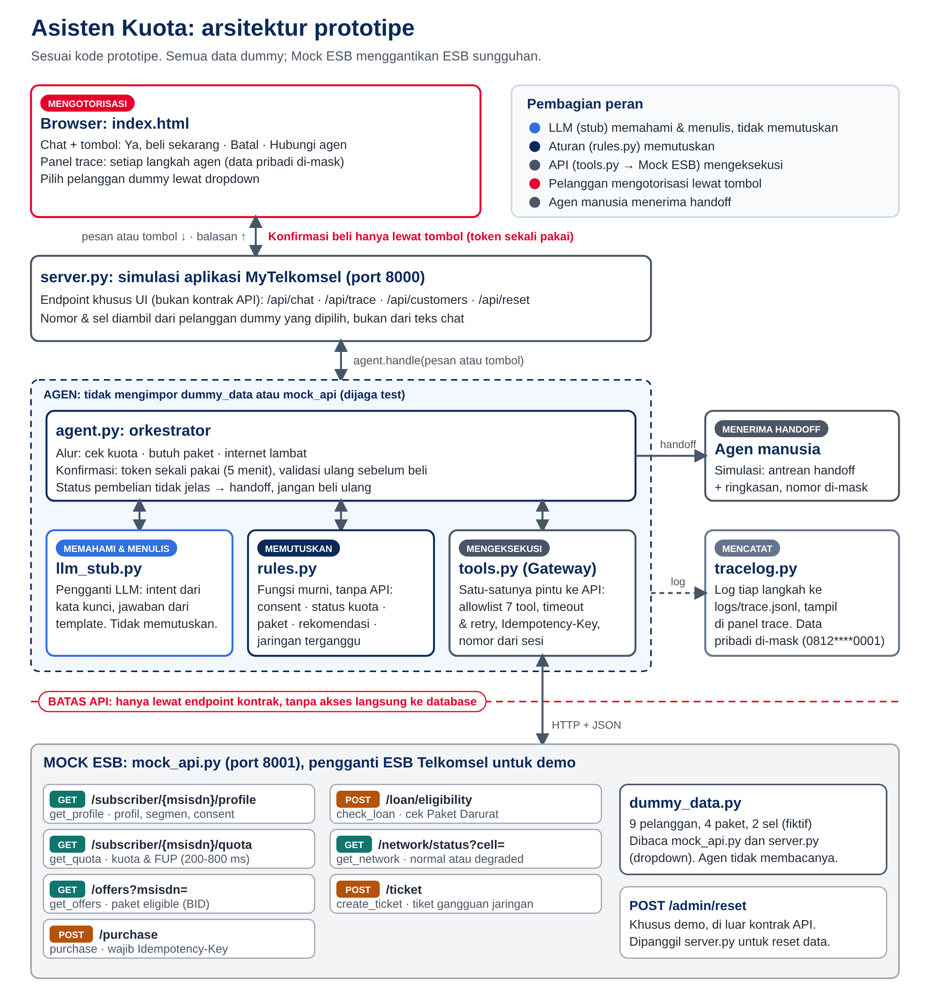

# Asisten Kuota - Prototipe (D4)

Prototipe agen AI "Asisten Kuota" di MyTelkomsel untuk case study IJP **Officer - Mobile Product Delivery**.
Agen bisa **bertindak**, bukan hanya menjawab: mendiagnosis kuota/FUP/jaringan, merekomendasikan dan membeli paket
(hanya setelah pelanggan menekan tombol konfirmasi), menawarkan Paket Darurat, membuat tiket gangguan, dan
menyerahkan ke agen manusia.

> **Semua data FIKTIF.** Tidak ada data pelanggan, kode, atau dokumen internal Telkomsel yang asli.
> Tidak ada koneksi ke sistem produksi. Bentuk JSON API adalah **skema usulan prototipe**, bukan spesifikasi Telkomsel.

## Cek cepat terhadap syarat D4

| Syarat D4 (dari case study) | Di prototipe ini |
|---|---|
| Agen dengan tool calling minimal 3 tool ke mock API | 7 tool = 7 endpoint kontrak (`tools.py`), dipanggil lewat satu gateway |
| UI web/chat sederhana | `index.html` (chat + panel trace), tanpa library eksternal |
| Konfirmasi sebelum pembelian | Wajib lewat **tombol** bertoken; "ya" yang diketik tidak membeli |
| Log/trace setiap langkah agen | Panel trace di UI + file `logs/trace.jsonl`, data pribadi di-mask |
| Data dummy minimal 5 pelanggan, kondisi berbeda | 9 pelanggan (`dummy_data.py`) |
| LLM dan framework bebas | Python bawaan saja. **LLM-nya stub** (lihat "Yang belum ada") |
| Repo Git + README cara menjalankan | File ini + `git init` (lihat bawah) |
| Video demo maks. 3 menit | **Belum ada.** Rekam sendiri mengikuti `DEMO_SCRIPT.md` |

## Arsitektur


## Demo
[](https://youtu.be/OlyiUIJwpFE)

## Cara menjalankan

Kebutuhan: **Python 3** (diuji di 3.11, 3.12, dan 3.13; sintaksnya tidak memakai fitur di atas 3.9). Tidak perlu `pip install` apa pun.

```bash
python run.py
```

Lalu buka **http://127.0.0.1:8000** di browser. Hentikan dengan `Ctrl+C`.

- Pilih pelanggan dummy di dropdown (ini menyimulasikan "siapa yang login di MyTelkomsel").
- Ketik pesan atau pakai tombol pintasan. Panel kanan menampilkan trace setiap langkah.
- Tombol **Reset data mock** mengembalikan saldo, kuota, dan tiket ke kondisi awal (berguna sebelum demo).
- Port bentrok? Ganti: `APP_PORT=9000 MOCK_PORT=9001 python run.py` (Windows PowerShell: `$env:APP_PORT=9000; $env:MOCK_PORT=9001; python run.py`).

Menjalankan test otomatis (36 test, sekitar 2 detik):

```bash
python -m unittest -v
```

## Menjalankan dengan Docker

Kebutuhan: Docker dengan Compose v2. Tidak perlu Python di komputer.

```bash
docker compose up --build
```

Buka **http://localhost:8000** (mock API ada di http://localhost:8001). Berhenti dengan `Ctrl+C`, lalu `docker compose down`.

| Perlu | Perintah |
|---|---|
| Ganti port di sisi host | `APP_PORT=9000 MOCK_PORT=9001 docker compose up --build` (PowerShell: `$env:APP_PORT=9000; $env:MOCK_PORT=9001; docker compose up --build`) |
| Jalankan test di container | `docker compose run --rm app python -m unittest -v` |
| Lihat log trace | `docker compose run --rm app cat logs/trace.jsonl` |
| Hapus container + log | `docker compose down -v` (tanpa `-v`, log di volume `trace-logs` tetap ada) |
| Status container (sehat atau tidak) | `docker compose ps` |

Tanpa Compose:

```bash
docker build -t asisten-kuota:prototype .
docker run --rm --init -p 127.0.0.1:8000:8000 -p 127.0.0.1:8001:8001 asisten-kuota:prototype
```

Catatan keamanan:
- **Tulis `127.0.0.1:` di depan port.** Aplikasi ini tidak punya login. `-p 8000:8000` (tanpa `127.0.0.1:`) membukanya ke seluruh jaringan. `docker-compose.yml` sudah memakai `127.0.0.1`.
- Di dalam container server mendengarkan `0.0.0.0` (`BIND_HOST` di `Dockerfile`), karena kalau tidak, port tidak bisa dipublikasikan. Di luar Docker, bawaannya tetap `127.0.0.1`.
- Container berjalan sebagai user biasa (uid 10001), bukan root. `init: true` membuat `docker stop` berhenti cepat.
- Image hanya berisi Python dan file proyek. Tidak ada rahasia, kredensial, atau akses ke sistem Telkomsel.

## Pelanggan dummy

Nomor `0812000000NN` hanyalah pola nomor uji, bukan nomor pelanggan sebenarnya.

| Nomor | Kondisi | Yang didemokan |
|---|---|---|
| 081200000001 | Kuota habis, pulsa Rp60.000 | **S1**: rekomendasi paket + konfirmasi + beli |
| 081200000002 | Kuota habis, pulsa Rp1.500, layak Paket Darurat | **S2**: cek `/loan/eligibility` + Paket Darurat |
| 081200000003 | Kuota 4 GB, sel `CELL-002` terganggu | **S3**: diagnosis jaringan + tiket (setelah konfirmasi) |
| 081200000004 | Pulsa Rp1.000, tidak layak Paket Darurat | Tidak ada opsi beli, tawarkan agen |
| 081200000005 | Belum memberi consent | Agen berhenti, tidak membaca data lain |
| 081200000006 | Kuota ada tapi FUP aktif | "Lambat" = FUP, **tidak** dibuatkan tiket jaringan |
| 081200000007 | Respons pembelian timeout | **Idempotency**: retry dengan key sama, bayar sekali |
| 081200000008 | API pembelian error terus | Status tidak jelas: **jangan beli ulang**, handoff |
| 081200000009 | Kuota & jaringan normal, tapi merasa lambat | Tidak ada tiket, tawarkan agen |

Contoh kalimat: `kuota saya habis`, `internet saya lambat`, `cek sisa kuota`, `sambungkan ke agen`.

## Cara kerja singkat

```
Pelanggan -> index.html -> server.py -> agent.py (orkestrator)
                                          |-- llm_stub.py   memahami maksud + menulis kalimat   (TIDAK memutuskan)
                                          |-- rules.py      KEPUTUSAN bisnis (deterministik)
                                          '-- tools.py      Tool Gateway -> HTTP -> mock_api.py (7 endpoint)
                                          tracelog.py mencatat semua langkah (di-mask)
```

Alur "kuota habis" (S1): `get_profile` (cek consent) -> `get_quota` -> `get_offers` -> rule engine memilih paket ->
**tombol konfirmasi** -> validasi ulang (`get_profile`, `get_offers`) -> `purchase` dengan `Idempotency-Key` -> `get_quota` baru.

## Peta kode (untuk menjelaskan setiap baris)

Urutan membaca yang disarankan: dari atas ke bawah.

| File | Baris | Peran | Keputusan desain yang perlu bisa dijelaskan |
|---|---|---|---|
| `dummy_data.py` | 120 | Data fiktif: paket, sel, 9 pelanggan | Hanya dibaca `mock_api.py`. Agen tidak pernah mengimpornya (dijaga test) |
| `mock_api.py` | 264 | Tiruan 7 endpoint kontrak + `/admin/reset` | Validasi tetap di backend meski agen sudah memeriksa. Idempotency: key sama = hasil lama |
| `tracelog.py` | 62 | Trace + masking data pribadi | Semua log wajib lewat `mask()`. Nomor `0812****0001`, nama/email `***` |
| `tools.py` | 95 | Tool Gateway | Allowlist 7 tool; msisdn dari sesi (bukan teks chat); purchase wajib key; retry hanya timeout/5xx |
| `rules.py` | 50 | Rule engine (fungsi murni) | Semua keputusan di sini agar LLM tidak memutuskan |
| `llm_stub.py` | 213 | Pengganti LLM: intent + kalimat | Kalimat hanya berisi fakta dari argumen (hasil API), tidak ada angka karangan |
| `agent.py` | 386 | Orkestrator, konfirmasi, handoff | Token konfirmasi sekali pakai; validasi ulang sebelum beli; status tidak jelas = handoff |
| `server.py` | 135 | Server web + simulasi konteks aplikasi | Bawaan hanya `127.0.0.1` (di Docker: lihat bagian Docker); satu pesan diproses satu per satu (kunci) |
| `index.html` | 225 | UI chat + panel trace | Memakai `textContent` (bukan `innerHTML`) agar aman dari injeksi |
| `test_agent.py` | 441 | 36 test ujung ke ujung | Test dijalankan terhadap mock API sungguhan; kondisi gagal sengaja disimulasikan |
| `Dockerfile`, `docker-compose.yml`, `.dockerignore` | 55 | Menjalankan di container | Non-root, port hanya loopback host, `init: true`, healthcheck, log di volume |

### Keputusan desain utama

1. **LLM menjelaskan, aturan memutuskan, API mengeksekusi, pelanggan mengotorisasi.** Ini mencegah halusinasi eligibility dan pembelian tanpa izin.
2. **Konfirmasi hanya lewat tombol.** Tombol membawa token acak sekali pakai yang terikat ke paket dan harga yang ditampilkan, berlaku 5 menit. Teks "ya" tidak pernah dianggap konfirmasi, jadi salah paham maksud tidak bisa menjadi pembelian.
3. **Idempotency-Key** = hash dari (nomor, paket, ID percakapan, token konfirmasi). Satu usulan = satu key. Retry memakai key yang sama, sehingga timeout tidak bisa membuat pembelian ganda. Tombol yang ditekan dua kali mengembalikan jawaban lama tanpa memanggil API lagi.
4. **Validasi ulang sebelum membeli.** Harga atau saldo bisa berubah sejak tombol ditampilkan. Kalau berubah, pembelian dibatalkan.
5. **Status pembelian tidak jelas (timeout/5xx setelah semua retry) = jangan beli ulang, serahkan ke manusia.** Kontrak tidak punya endpoint cek status transaksi, jadi ini pilihan teraman.
6. **Diagnosis berurutan: consent -> kuota/FUP -> baru jaringan.** Kalau penyebab lambat adalah kuota atau FUP, tiket jaringan tidak dibuat. Inilah masalah bisnis "keluhan lambat yang ternyata kuota".
7. **Tiket tidak di-retry otomatis** dan mock mengembalikan tiket lama untuk nomor + sel yang sama, supaya tidak ada banjir tiket.
8. **Minimisasi data.** Dari profil hanya saldo yang disimpan; nama dan email dibuang saat itu juga dan tidak masuk log.

## Guardrail dan lokasinya di kode

| Kontrol | Di mana |
|---|---|
| Consent sebelum data diambil | `agent.py` `diagnose_quota()`; backend juga menolak (`mock_api.py` `CONSENT_REQUIRED`) |
| Masking data pribadi di log | `tracelog.py` `mask()`, dites di `test_logs_are_masked` |
| Prompt injection | Teks pelanggan hanya jadi *intent*; tool hanya dipilih orkestrator; allowlist 7 tool; msisdn dari sesi |
| Otorisasi tool | `tools.py` allowlist; `purchase` tanpa key ditolak sebelum dikirim |
| Konfirmasi eksplisit | `agent.py` `confirm()`; `test_typed_yes_never_buys` |
| Anti pembelian ganda | `Idempotency-Key` + token sekali pakai; `test_double_tap_confirm_buys_once`, `test_purchase_timeout_...` |
| Audit | Trace setiap langkah (`test_every_step_is_traced`) |
| Eskalasi manusia | Minta agen, marah, tidak paham 2x, API gagal 2x, status pembelian tidak jelas |
| Tanpa akses database produksi | Agen hanya HTTP ke API; `test_agent_has_no_direct_data_access` |

## Yang belum ada / asumsi (jujur, supaya tidak mengejutkan penilai)

**Belum ada di prototipe:**
- **Tidak ada LLM sungguhan.** `llm_stub.py` membaca kata kunci dan memakai template kalimat. Ini sengaja: bisa dijalankan tanpa API key dan perilakunya bisa dites. Konsekuensinya, pemahaman bahasa bebas terbatas, dan "tool calling" dilakukan orkestrator berbasis aturan, bukan LLM yang memilih fungsi.
- **Biaya LLM (target Rp250/percakapan) tidak diukur**, karena tidak ada LLM. Angka di slide 5 adalah ilustrasi.
- **Retensi data baru berupa kebijakan, belum ada kode penghapusan.** Usulan: percakapan ter-mask 30 hari, log transaksi ter-mask 12 bulan, keputusan akhir ada di Legal/DPO. `logs/trace.jsonl` bertambah terus.
- **Tidak ada autentikasi.** "Login" adalah dropdown. Bawaannya server hanya mendengarkan `127.0.0.1`; di Docker, port hanya dipublikasikan ke `127.0.0.1` host. Jangan dibuka ke jaringan.
- Handoff ke agen manusia adalah **simulasi lokal** (ringkasan ditampilkan di UI dan trace). Kontrak tidak punya endpoint handoff.
- Deteksi marah hanya daftar kata. Rekomendasi paket hanya aturan sederhana (paling hemat per GB dari yang terjangkau pulsa).

**Asumsi yang perlu dikonfirmasi ke pemilik sistem sungguhan:**
1. Kontrak tidak memberi skema JSON, jadi semua skema adalah usulan (lihat `API_DOCS.md`).
2. Kontrak tidak menyebut sumber **saldo pulsa**. Prototipe menambahkan field `balance_idr` di respons profil.
3. Kontrak tidak menyebut sumber **cell ID**. Prototipe mengambilnya dari konteks aplikasi (di demo: dari dropdown).
4. Aturan Paket Darurat: limit berlaku untuk harga paket, biaya layanan ditambahkan, dibayar dari top-up berikutnya, sekali pakai.
5. Prototipe **tidak mengklaim** bahwa membeli paket menghilangkan FUP; agen hanya menawarkan paket.
6. Tidak ada endpoint untuk memberi consent: bila belum ada, agen berhenti dan mengarahkan ke menu Privasi.
7. Timeout dan retry (GET 2 detik retry 1x; purchase 5 detik retry 2x dengan key sama) adalah angka usulan.

## Bagian yang dibantu AI (WAJIB Anda lengkapi sebelum diserahkan)

Aturan penilaian: tuliskan bagian mana yang dibantu AI, dan peserta harus bisa menjelaskan setiap baris kode dan setiap keputusan desain.

- **Dibantu AI:** seluruh draft awal kode (`*.py`, `index.html`), test otomatis, dan dokumen ini dibuat dengan bantuan **Claude (Anthropic)** berdasarkan materi case study, kemudian dijalankan dan diuji (36 test lulus; skenario S1, S2, S3, timeout, dan handoff dicoba di browser).
- **Dikerjakan sendiri:** `[ISI SENDIRI: apa yang Anda baca, ubah, jalankan, dan putuskan. Jangan klaim lebih dari yang benar-benar Anda kerjakan.]`

Checklist sebelum menyerahkan. Pastikan Anda bisa menjawab tanpa membuka kode:
- Mengapa "ya" yang diketik tidak membeli? Apa yang terjadi bila tombol ditekan dua kali?
- Apa itu Idempotency-Key, siapa yang membuatnya, dan mengapa retry memakai key yang sama?
- Apa beda tugas `llm_stub.py`, `rules.py`, dan `tools.py`?
- Mengapa status pembelian yang tidak jelas berujung handoff, bukan beli ulang?
- Pelanggan 081200000006 mengeluh lambat. Mengapa tidak ada tiket jaringan?
- Bagian mana yang bukan fakta dari kontrak (semua di "Asumsi" di atas)?

## Mengganti stub dengan LLM sungguhan (langkah berikutnya)

Hanya `llm_stub.py` yang perlu diganti; `agent.py` tidak berubah.
1. `understand(text)`: kirim teks ke LLM dengan instruksi memilih satu intent dari daftar tetap, lalu **validasi** hasilnya terhadap daftar itu (di luar daftar = `unknown`).
2. `say_*`: bisa tetap template, atau LLM menulis kalimat **hanya dari fakta yang diberikan** (kuota, harga, nama paket).
3. Jangan pernah memberi LLM akses ke tool `purchase`, jangan kirim nama/email/nomor ke LLM, dan tambahkan penghitung token supaya batas Rp250 per percakapan terpantau.

## Membuat repo Git

```bash
git init
git add .
git commit -m "Prototipe Asisten Kuota (D4)"
```
`.gitignore` sudah mengecualikan `logs/` dan `__pycache__/`.
